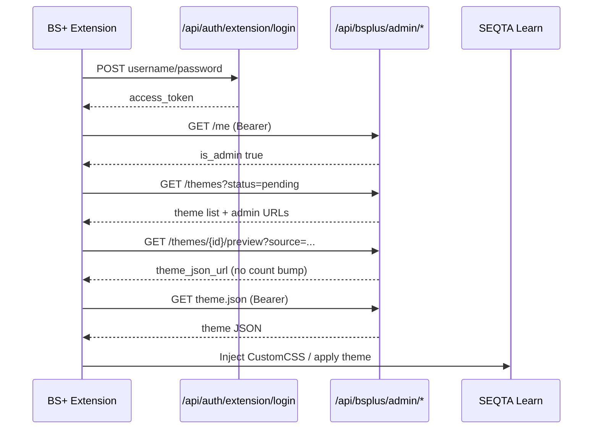

# BetterSEQTA+ Admin Theme Preview API

API for the **BetterSEQTA+ extension client** so site admins can browse, preview, and apply BetterSEQTA themes on SEQTA **before public approval**, without increasing public download counts.

These routes are separate from the web admin panel (`/api/admin/...`) and from normal store flows (`/api/themes/...`).

---

## Authentication

Admins use the same extension login as everyone else, then send the bearer token on every admin preview call.

### 1. Log in (extension)

**`POST /api/auth/extension/login`**

```json
{ "username": "your-account", "password": "your-password" }
```

**Response:**

```json
{
  "access_token": "eyJ...",
  "expires_in": 3600
}
```

### 2. Confirm admin access

**`GET /api/bsplus/admin/me`**

**Headers:** `Authorization: Bearer <access_token>`

**Response (admin):**

```json
{
  "success": true,
  "data": {
    "id": "...",
    "username": "...",
    "admin_level": 1,
    "is_admin": true
  },
  "error": null,
  "meta": { "timestamp": 0, "version": "1.0.0" }
}
```

**Errors:**

| Status | Meaning |
|--------|---------|
| `401` | Missing or invalid token |
| `403` | Valid user but not an admin (`admin_level < 1`) |

You can also use **`GET /api/auth/me`** with the same bearer token; check `admin_level >= 1` before showing admin UI.

---

## Theme sources

Every theme belongs to one of two sources. Pass **`source`** on detail, preview, and `theme.json` requests (required).

| `source` | Table | Description |
|----------|--------|-------------|
| `marketplace` | `themes` | Official store / extension uploads (admin moderation queue) |
| `community` | `custom_themes` | User-submitted community themes |

Theme IDs are UUIDs and could theoretically collide across tables, so **`source` is required** wherever a single ID is used.

Only **`theme_type: betterseqta`** themes appear in these APIs (DesQTA ZIP themes are out of scope for BS+ preview).

---

## Endpoints

All admin preview routes require:

```
Authorization: Bearer <access_token>
```

### List themes (including pending)

**`GET /api/bsplus/admin/themes`**

| Query | Description |
|-------|-------------|
| `page` | Page number (default `1`) |
| `limit` | Page size (default `20`, max `100`) |
| `status` | `pending`, `approved`, or `rejected` |
| `search` | Matches name, description, author, slug |
| `source` | `marketplace`, `community`, or omit for both |

**Example — pending community themes:**

```http
GET /api/bsplus/admin/themes?status=pending&source=community
Authorization: Bearer eyJ...
```

**Response:**

```json
{
  "success": true,
  "data": {
    "themes": [
      {
        "id": "...",
        "name": "My Theme",
        "slug": "my-theme",
        "description": "...",
        "author": "...",
        "status": "pending",
        "theme_type": "betterseqta",
        "created_at": 1700000000,
        "updated_at": 1700000000,
        "preview": { "thumbnail": "https://...", "screenshots": [] },
        "coverImage": "https://...",
        "source": "community",
        "admin_preview_url": "https://betterseqta.org/api/bsplus/admin/themes/.../preview?source=community",
        "admin_theme_json_url": "https://betterseqta.org/api/bsplus/admin/themes/.../theme.json?source=community"
      }
    ],
    "pagination": { "page": 1, "limit": 20, "total": 3, "totalPages": 1 }
  },
  "error": null,
  "meta": { "timestamp": 0, "version": "1.0.0" }
}
```

---

### Theme detail (any status)

**`GET /api/bsplus/admin/themes/{id}?source=marketplace|community`**

Returns metadata similar to the public theme detail shape, plus `source`, `admin_preview_url`, and `admin_theme_json_url`. Works for **pending**, **approved**, and **rejected** themes.

Community entries may include `submission_notes` and `rejection_reason`.

---

### Preview / apply (no download count)

**`GET /api/bsplus/admin/themes/{id}/preview?source=marketplace|community`**

Use this instead of **`GET /api/themes/{id}/download`** when an admin is testing in the extension.

| Public download API | Admin preview API |
|---------------------|-------------------|
| Only **approved** themes | **Any** status |
| Increments `download_count` | **Does not** increment |
| Returns public `theme_json_url` | Returns **`admin_theme_json_url`** (works for pending community themes) |

**Response:**

```json
{
  "success": true,
  "data": {
    "theme_json_url": "https://betterseqta.org/api/bsplus/admin/themes/{id}/theme.json?source=community",
    "source": "community",
    "status": "pending",
    "preview": true,
    "counts_toward_downloads": false,
    "download_count": 0
  },
  "error": null,
  "meta": { "timestamp": 0, "version": "1.0.0" }
}
```

`download_count` is the **current** public counter (unchanged by this call).

---

### Fetch `theme.json` (authenticated)

**`GET /api/bsplus/admin/themes/{id}/theme.json?source=marketplace|community`**

**Headers:** `Authorization: Bearer <access_token>`

**Response:** `application/json` body — same as production `theme.json`, suitable for applying in BS+.

- **Pending community themes:** public `GET /api/custom-themes/{id}/theme.json` returns `404` until approved; use this admin URL instead.
- **Pseudo / external marketplace themes:** may `302` redirect to the external JSON URL (same as the public endpoint).
- **Cache:** `Cache-Control: private, no-store` (admin-only, not CDN-cached like public assets).

When calling this URL from the extension, attach the **same bearer token** on the request.

---

## Recommended client flow



1. Log in with **`POST /api/auth/extension/login`**.
2. Call **`GET /api/bsplus/admin/me`**. If not admin, hide preview tools.
3. List candidates with **`GET /api/bsplus/admin/themes`** (e.g. `status=pending`).
4. For apply/test: **`GET .../preview?source=...`** → read `theme_json_url`.
5. **`GET`** that URL with **`Authorization: Bearer ...`** → parse JSON → apply like a normal store theme.
6. For production users, keep using **`GET /api/themes/{id}/download`** (counts downloads, approved only).

---

## Example requests

```bash
TOKEN="eyJ..."

# Am I an admin?
curl -s "https://betterseqta.org/api/bsplus/admin/me" \
  -H "Authorization: Bearer $TOKEN"

# Pending themes (both sources)
curl -s "https://betterseqta.org/api/bsplus/admin/themes?status=pending" \
  -H "Authorization: Bearer $TOKEN"

# Preview (no download increment)
curl -s "https://betterseqta.org/api/bsplus/admin/themes/THEME_ID/preview?source=community" \
  -H "Authorization: Bearer $TOKEN"

# Fetch theme.json for apply
curl -s "https://betterseqta.org/api/bsplus/admin/themes/THEME_ID/theme.json?source=community" \
  -H "Authorization: Bearer $TOKEN"
```

---

## Related docs

- [Extension Themes API](./extension-themes-api.md) — public store, extension login, and normal download flow
- Web admin moderation (browser): `/admin/themes`, `/admin/custom-themes` (not used by the extension client)
